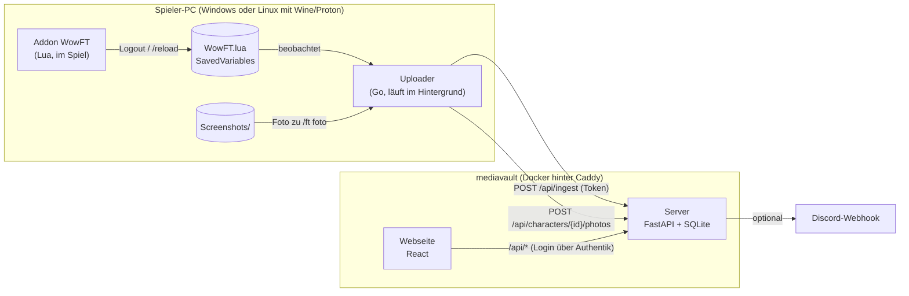

# Übergabe: WoW Forever Freundes-Tracker

Stand: 07.11.2026 · Branch `main`

Dieses Dokument soll reichen, um ohne Vorwissen weiterzuarbeiten, egal ob selbst
oder mit Claude Code. Details stehen in den verlinkten Dokumenten; hier steht, wie alles
zusammenhängt und was als Nächstes ansteht.

---

## 1. Was die App macht

Eine Freundesrunde spielt WoW Forever. Jede Person sieht auf einer Webseite (auch am Handy),
wer welches Level hat, wie schnell jemand levelt, was im Spiel passiert ist (Level-Ups,
Berufe, Items, Tode, Bosse) und wer welche Handwerksmaterialien hat.

Das Problem dabei: **WoW-Addons haben keinen Netzwerkzugriff.** Sie können nur eine Datei
(SavedVariables) schreiben, und das auch nur bei Logout oder `/reload`. Deshalb gibt es
vier Teile:



„Live“ heißt deshalb immer: **so aktuell wie der letzte Logout oder `/reload`**. Die Webseite
zeigt oben, wann der jüngste Upload kam.

---

## 2. Die Teile im Einzelnen

### Addon (`addon/WowFT/`)

| Datei | Aufgabe |
|---|---|
| `WowFT.toc` | Addon-Beschreibung, Interface-Nummer (`16001`, Forever-Build 1.60.1), SavedVariable `WowFTDB` |
| `Util.lua` | Reine Hilfsfunktionen ohne WoW-API (Ringpuffer, DB-Initialisierung, Spielzeit-Hochrechnung) |
| `Core.lua` | Events, Snapshots, Level-Ups, Tode, Bosse, Slash-Befehle `/ft …` |
| `Collect.lua` | Phase-4-Sammler: Berufe, Ausrüstung, Ruf, Talente, Material. Jeder läuft in `pcall`; Fehler landen in `apiErrors` und `/ft status` zeigt sie. |
| `UI.lua` | Minimap-Button (Tooltip mit Level, XP, Snapshot-Stand; Linksklick Einstellungen, Rechtsklick Foto, verschiebbar). Keine eigene XP-Leiste. |
| `Settings.lua` | Einstellungsfenster (`/ft config`): Server und Upload-Token (landen in `WowFTDB.upload`), Schalter für Gold, Material und Minimap-Button |
| `Photo.lua` | `/ft foto`: Vollbild mit 3D-Modell, löst Screenshot aus, merkt sich den Zeitpunkt |

Befehle: `/ft config|show|hide|status|snap|foto|api`, `/ft gold an|aus`, `/ft material an|aus`.

Charaktere werden über die **GUID** identifiziert, weil Forever keine Realms hat
(ein Mega-Server pro Region).

### Uploader (`uploader/`, Go, keine Fremdabhängigkeiten)

| Datei | Aufgabe |
|---|---|
| `main.go` | Flags: `-setup`, `-once`, `-find`, `-autostart on\|off`, `-background`, `-config` |
| `addonsettings.go` | Liest Server und Token aus `WowFTDB.upload` (Vorrang vor `config.json`) und leert den Token vor dem Upload |
| `setup.go` | Einrichtungsdialog (Server, Kopplung, WoW-Ordner) |
| `addoninstall.go` | Bettet das Addon ein (`go generate` kopiert `addon/WowFT` nach `addonfiles/`), installiert es in den Forever-Spielordner und aktualisiert ältere Versionen (Vergleich über `## Version` in der `.toc`; neuere bleiben). Beim Start und stündlich; abschaltbar mit `"addonInstall": false` in `config.json` |
| `updater.go` | Selbstaktualisierung: prüft beim Start und stündlich das neueste GitHub-Release, lädt die passende Datei, vergleicht sie mit `SHA256SUMS.txt`, tauscht die laufende Datei aus und startet neu (unter systemd per Exit-Code 75). `-update` prüft sofort; `"autoUpdate": false` in `config.json` schaltet es ab; selbst gebaute Versionen (`dev`) aktualisieren sich nie |
| `pair.go` | Kopplung: Gerätecode anzeigen, Browser öffnen, Token abholen; Code fürs Spiel (`WFT-XXXX-XXXX`) aus `WowFTDB.upload` einlösen |
| `discover.go` | Findet `WowFT.lua` unter dem WoW-Ordner (Groß-/Kleinschreibung egal); bekannte Installationsorte inkl. Lutris, Bottles, Steam/Proton, Heroic |
| `search.go` | Fallback: durchsucht Laufwerke bzw. Home nach `Wow*.exe` oder `WTF`+`Interface` (Exe-Name von Forever ist unbekannt) |
| `watch.go` | Prüft alle 5 s, wartet 3 s nach Änderung, lädt hoch, Backoff bei Netzfehlern, merkt sich Hashes in `state.json` |
| `upload.go` | HTTP: gzip-Upload der Rohdatei, Foto-Upload |
| `photo.go` | Screenshot zu `/ft foto` finden, Mitte 3:4 ausschneiden, 600×800 JPEG |
| `autostart_*.go` | Windows: Registry-Run-Key · Linux: systemd-Benutzerdienst, sonst XDG-Autostart |

Konfiguration und Log liegen in `~/.config/wowft/` bzw. `%APPDATA%\wowft\`.

### Server (`server/wowft/`, Python 3.12, FastAPI, SQLAlchemy, Alembic, SQLite)

| Datei | Aufgabe |
|---|---|
| `svparse.py` | Liest die Lua-Datei als Daten (führt nie Lua aus). Einziger Parser im System. |
| `ingest.py` | Validiert (Pydantic), schreibt Snapshots/Ereignisse doppelt-sicher, speichert Charakter-Zustand, meldet fehlende Fotos zurück |
| `events.py` | Leitet Feed-Ereignisse aus Zustandsänderungen ab; deutsche Texte für Feed und Discord |
| `metrics.py` | XP-Tabelle (Classic-Werte), XP/Stunde, Zeit bis Level 60 |
| `auth.py` | Authentik-Login (OIDC), Session-Cookie, Upload-Tokens (SHA-256), Admin-Prüfung, Rate-Limit |
| `features.py` | Module, die Admins seitenweit schalten (bisher: Rennen) |
| `privacy.py` | Freigaben je Charakter und Kategorie; zentrale Stelle für „wer sieht was“ |
| `icons.py` | Talent-Icons: Icon-Name je Zauber-ID bei Wowhead nachschlagen (nach dem Upload im Hintergrund, Ergebnis in `spell_icons`), Bild beim ersten Abruf laden und unter `data/icons/` speichern; `/api/icons/<name>.jpg` liefert es aus. Die Browser fragen nie Dritte. Abschaltbar mit `WOWFT_ICON_LOOKUP=false` |
| `dungeons.py` | Dungeon-Planer: Dungeons/Schlachtzüge mit Stufenbereichen (Classic-Werte, für Forever prüfen) und deutschen/englischen Instanznamen, um besiegte Bosse zuzuordnen. Endpunkt `/api/groups/{id}/dungeons`; die Zuordnung „wer passt“ macht `web/src/dungeons.ts` |
| `discord.py` | Posts an Gruppen-Webhooks (nur Ereignisse der letzten 12 h) |
| `api/*.py` | Endpunkte: `requests` (Material-Wünsche), `ingest`, `me` (Profil, Tokens, eigene Charaktere), `groups` (Gruppen, Einladungen, Übersicht, Feed, Rennen, Material), `characters` (Verlauf/Detail), `photos`, `admin`, `pairing` (Uploader koppeln) |
| `models.py` | Tabellen: users, groups, group_members, tokens, characters (mit `state`-JSON), snapshots, events, photos, app_settings, pairings, spell_icons, material_requests |
| `alembic/versions/` | Migrationen `0001` (Grundschema), `0002` (Seiteneinstellungen), `0003` (Freigaben), `0004` (Kopplung), `0005` (Talent-Icons), `0006` (Material-Wünsche). **Ab jetzt nur neue Migrationen anlegen, alte nicht mehr ändern.** |

Die API-Doku gibt es im laufenden Server unter `/api/docs`.

### Webseite (`web/src/`, React + TypeScript + Vite, keine UI-Bibliothek)

| Datei | Aufgabe |
|---|---|
| `App.tsx` | Login-Prüfung, Routen, Navigation (Rennen nur bei aktivem Modul) |
| `pages/` | Übersicht, Charakter, Rennen, Dungeons, Material, Feed, Profil (Tokens, Gruppen, Discord, Admin), Einladung |
| `components/` | „Wer ist wo“, Charakterkarte, Diagramm (eigenes SVG), Feed-Zeile, Aktualitäts-Hinweis |
| `sort.ts`, `format.ts`, `wow.ts` | Sortierung/Gruppierung, deutsche Formate, Klassen- und Qualitätsfarben |

Aussehen: dunkles Thema, Klassenfarben als einzige kräftige Farben, mobil zuerst.
Ansicht: [`docs/ui-mockup.png`](ui-mockup.png).

---

## 3. Wie die Daten fließen

1. Addon sammelt im Spiel → `WowFTDB` (Format: [`datenvertrag.md`](datenvertrag.md)).
2. Logout/`/reload` → WoW schreibt `WTF/Account/<NAME>/SavedVariables/WowFT.lua`.
3. Uploader sieht die Änderung → `POST /api/ingest` mit dem Upload-Token der Person.
4. Server parst, legt unbekannte GUIDs als neue Charaktere dieser Person an, speichert neue
   Snapshots und Ereignisse (Duplikate werden ignoriert), vergleicht den Zustand mit dem vorigen
   und erzeugt Feed-Ereignisse, postet ggf. nach Discord.
5. Antwort enthält `photoRequests` → Uploader sucht den passenden Screenshot und lädt ihn hoch.
6. Webseite liest über die Session des eingeloggten Nutzers nur Gruppen, in denen er Mitglied ist.

**Sichtbarkeit (Freigaben):** Alle Mitglieder einer Gruppe sehen die sichtbaren Charaktere der
anderen („in Gruppen zeigen“ pro Charakter). Darüber hinaus kann der Besitzer je Charakter einzelne
Kategorien ausblenden (Profil → „Was sehen die anderen?“): Spielzeit, Tempo (XP/Std.), Gold, Aufenthaltsort,
Ausrüstung, Berufe, Ruf, Talente, Materialien, Tode, Boss-Kills, Foto. Level und XP sind immer sichtbar;
der Besitzer sieht seine Charaktere selbst immer vollständig. Entscheidend ist `server/wowft/privacy.py`:
Die Prüfung läuft auf dem Server und gilt für Übersicht, Detailseite, Feed, Material, Rennen, Foto-Abruf
und Discord. Ausgeblendetes verlässt den Server nicht. Standard: alles sichtbar außer Gold und Tempo.

**Spielzeit** ist für andere **nur sichtbar, wenn der Rennen-Modus an ist**, selbst wenn der Besitzer
sie freigegeben hat (Modus standardmäßig aus; dann gibt es auch die Spielzeit-Achse und -Sortierung nicht).
**Tempo** (XP/Std., Zeit bis Maximallevel) hat eine eigene Freigabe (`rate`), hängt nicht am
Rennen-Modus und ist **standardmäßig aus**: Aus Tempo und Gesamt-XP ließe sich die Spielzeit
ungefähr errechnen. Wer es zeigen will, gibt es selbst frei.

**Zwei getrennte Schlüssel:** Login (Authentik) für die Webseite, Upload-Token für den Uploader.
Den Token muss niemand abtippen: Der Uploader **koppelt** sich. Er zeigt einen kurzen Code und
öffnet `/koppeln`; nach dem Klick auf „Koppeln“ holt er mit seinem geheimen Schlüssel einen neuen
Token ab (genau einmal, Code 10 Minuten gültig). Ersatzweg: Im Profil einen „Code fürs Spiel“
(`WFT-XXXX-XXXX`, 15 Minuten, einmalig) erzeugen, im Spiel ins Token-Feld eintragen, `/reload`;
der Uploader tauscht ihn gegen einen Token. Der Server speichert dabei nie einen Token im Klartext;
er entsteht erst beim Abholen (`server/wowft/api/pairing.py`).
Auf dem Spielrechner steht nie ein Passwort.

---

## 4. Stand

| Bereich | Stand |
|---|---|
| Phasen 0–4 aus dem Plan | programmiert und mit automatischen Tests abgedeckt |
| Phase 5 (Live-Abgleich im Spiel über Battle.net) | offen |
| Im echten Spiel getestet | **nein** – alles gegen nachgebaute WoW-API |
| Auf mediavault deployt | **ja** (07.11.2026, Release v0.5.0, Migration 0006; Authentik-Login und Gruppen dort noch nicht durchgespielt) |
| Docker-Image gebaut | nur in der CI (dort mit Docker), lokal nicht |
| Authentik-Login gegen echtes Authentik | **nein** (nur Testlogin `WOWFT_DEV_LOGIN`) |

Tests: Befehle in Abschnitt 6, aktuelle Läufe in der CI. Details zum Stand pro Schritt:
[`umsetzungsplan.md`](umsetzungsplan.md).

---

## 5. Was jetzt zu tun ist

In dieser Reihenfolge:

### A. Im Spiel prüfen (blockiert alles Weitere)

Checkliste: [`client-check.md`](client-check.md). Am wichtigsten:

1. Interface-Nummer: `/dump select(4, GetBuildInfo())` → in `addon/WowFT/WowFT.toc` eintragen.
2. Name des Spielordners (`_forever_`?) und der Programmdatei notieren.
3. Addon nach `World of Warcraft/_<ordner>_/Interface/AddOns/WowFT` kopieren, einloggen.
4. `/ft status` → steht dort „API-Problem bei …“, betroffenen Sammler in `Collect.lua` anpassen.
5. Prüfen, ob der SavedVariables-Bug aus der Beta behoben ist (`/ft snap`, `/reload`, Neustart, `/ft status`).
6. `/ft foto` → „Foto aufnehmen“: Darf ein Addon `Screenshot()` auslösen? Sind Screenshots JPG?
7. Bank öffnen, Boss legen, `/reload` → kommt `ENCOUNTER_END` an?
8. XP-Werte stichprobenartig mit `server/wowft/metrics.py` vergleichen (Level 10/20/30).

### B. Deployment auf mediavault

Anleitung: [`deployment.md`](deployment.md).

1. In Authentik Provider + Application `wowft` anlegen, Redirect-URI
   `https://wow.the-birds.xyz/auth/callback`.
2. `deploy/.env` aus `.env.example` füllen, **`WOWFT_ADMIN_USERS` mit deinem Authentik-Namen**.
3. `docker compose up -d --build` (Updates: siehe `deployment.md`, Abschnitt 5), Caddy-Block aus `deploy/Caddyfile` übernehmen.
4. Login testen, Gruppe anlegen, Token erzeugen.
5. Backup per cron (`deploy/backup.sh`).

### C. Erster echter Durchlauf

1. Release taggen (`git tag v0.6.0 && git push origin v0.6.0`) → GitHub baut Uploader
   (Windows, Linux, macOS) und `WowFT-addon.zip`.
2. Selbst: Uploader `-setup`, spielen, ausloggen → erscheint der Stand auf der Seite?
3. Unter Linux zusätzlich `wowft-uploader -find` und den systemd-Dienst prüfen
   (`systemctl --user status wowft-uploader`) – der ist bisher ungetestet.
4. Dann Freunde einladen (Einladungslink im Profil), optional Discord-Webhook eintragen,
   als Admin das Rennen-Modul einschalten.

### D. Danach (offen, nach Bedarf)

- Tray-Symbol für den Windows-Uploader (zeigt „zuletzt hochgeladen“)
- Forever-Sammelziele, sobald klar ist, wie die API sie liefert
- Phase 5: Live-Abgleich im Spiel per `BNSendGameData` (vorher prüfen, ob vorhanden)
- Auf schmalen Handys wird der Nutzername im Menü abgekürzt → evtl. Profil-Symbol
- `.exe` signieren, falls SmartScreen die Freunde abschreckt

---

## 6. Lokal entwickeln

Voraussetzungen: Python 3.12+, Go 1.22+, Node 22.

```sh
# Server mit Testlogin (ohne Authentik)
cd server && python -m venv .venv && . .venv/bin/activate && pip install -e ".[dev]"
WOWFT_DEV_LOGIN=true WOWFT_ADMIN_USERS=ich python -m wowft      # http://localhost:8000

# Webseite mit Hot-Reload (leitet /api und /auth an den Server weiter)
cd web && npm install && npm run dev
# Anmelden: http://localhost:5173/auth/dev-login?name=ich

# Uploader gegen den lokalen Server
cd uploader && go run . -setup        # Server: http://localhost:8000
```

Beispieldaten ohne Spiel: `fixtures/WowFT.lua` (enthält alle Felder) – im Profil unter
„Datei von Hand hochladen“ auswählen.

### Tests (laufen auch in GitHub Actions bei jedem Push)

```sh
pip install pytest lupa && pytest addon/tests        # Addon mit eingebettetem Lua
cd server && pytest && ruff check . && ruff format --check .
cd uploader && go generate ./... && go vet ./... && go test ./...
cd web && npm test && npm run build
```

### Regeln, die sich bewährt haben

- **Datenvertrag zuerst:** Neue Werte zuerst in `docs/datenvertrag.md` und `fixtures/WowFT.lua`,
  dann Addon → Server (`ingest.py`, Pydantic-Modell) → Web. `fixtures/ingest.json` wird aus der
  Lua-Datei erzeugt (`python -m wowft.svparse ../fixtures/WowFT.lua`).
- **Releases sind Updates:** Jedes Tag `vX.Y.Z` wird von allen Uploadern (ab v0.5.0) innerhalb einer
  Stunde automatisch installiert, samt dem darin enthaltenen Addon. Nur von `main` taggen, nachdem
  die CI grün ist.
- **Addon-Version hochzählen** (`## Version` in `WowFT.toc` und `ns.VERSION` in `Util.lua`), wenn sich
  das Addon ändert. Nur dann ersetzt der Uploader die installierte Version bei den Freunden.
- **Neue Felder sind optional**, damit alte Addon-Versionen weiter hochladen können.
- **Addon-Code, der WoW-Funktionen aufruft, in `pcall`** (Forever kann abweichen).
- **Datenbank nur per neuer Alembic-Migration ändern**
  (`alembic revision --autogenerate -m "…"` im Ordner `server`).
- Texte auf der Seite und im Feed auf Deutsch; Feed-Texte kommen vom Server (`events.describe`).

---

## 7. Mit Claude Code weitermachen

- Im Repo-Wurzelordner `claude` starten. `CLAUDE.md` verweist auf dieses Dokument, damit eine
  neue Sitzung den Zusammenhang kennt.
- Gute Einstiegsaufträge: „Lies docs/UEBERGABE.md. Ich habe die Client-Prüfung gemacht,
  Ergebnisse: …“ oder „Hilf mir beim Deployment nach docs/deployment.md“.
